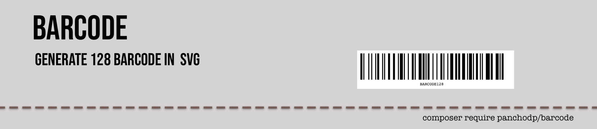

<p align="center"><a target="_blank"> </a></p>

<p align="center">
<a ></a>
<a ></a>
<a href="https://packagist.org/packages/panchodp/barcode"></a>
<a href="https://packagist.org/packages/panchodp/barcode"></a>
<a href="https://github.com/PanchoDP/barcode/actions/workflows/tests.yml"></a>
</p>

# Barcode 128 Generator

Generate Code 128 barcodes as SVG in PHP. No external dependencies, works in any PHP project and integrates with Laravel out of the box.

## Installation

```bash
composer require panchodp/barcode
```

## Usage

```php
use Barcode\Barcode;

$barcode = new Barcode();

// SVG markup
$svg = $barcode->generateSvg('ABC123');

// Data URL, ready for an  tag
echo 'generateSvgBase64('ABC123') . '" />';

// Save to a file
$barcode->generateSvgFile('ABC123', __DIR__ . '/barcode.svg');
```

In Laravel you can also use the facade or inject the class:

```php
use Barcode\Facades\Barcode;

$svg = Barcode::generateSvg('ABC123');
```

```php
public function show(\Barcode\Barcode $barcode)
{
    return response($barcode->generateSvg('ABC123'))
        ->header('Content-Type', 'image/svg+xml');
}
```

## Methods

| Method | Returns |
|--------|---------|
| `generateSvg(string $code, string $text = '', array $options = [])` | SVG markup. `$text` replaces the text shown under the bars. |
| `generateSvgBase64(string $code, array $options = [])` | `data:image/svg+xml;base64,...` string |
| `generateSvgFile(string $code, string $filename, array $options = [])` | The file path after saving the SVG |
| `generateWithOptions(string $code, int $width = 2, int $height = 60)` | Data URL (shortcut for bar width and height) |
| `validateCode(string $code)` | `true` if the code can be encoded |
| `generate(string $code)` / `getBinaryPattern(string $code)` | Raw bar pattern (`"1101001..."`) |

## Options

All options are optional. Values outside the allowed range are clamped.

| Option | Default | Range | Description |
|--------|---------|-------|-------------|
| `bar_width` | `2` | 1–50 | Width of each bar (px) |
| `bar_height` | `60` | 10–500 | Height of the bars (px) |
| `margin_left` / `margin_right` | `10` | 0–100 | Horizontal spacing (px) |
| `margin_top` / `margin_bottom` | `10` | 0–100 | Vertical spacing (px) |
| `background_color` | `#FFFFFF` | | Background color |
| `foreground_color` | `#000000` | | Bars and text color |
| `show_text` | `true` | | Show the text under the bars |
| `text_size` | `12` | 8–72 | Font size (px) |
| `text_margin` | `5` | 0–50 | Space between bars and text (px) |

```php
$svg = $barcode->generateSvg('ABC123', 'Order #123', [
    'bar_width' => 3,
    'bar_height' => 80,
    'foreground_color' => '#333333',
]);
```

## Limitations

- Codes must be 1–48 ASCII characters.
- The best code set is picked automatically: **C** for even-length numbers (4+ digits), **B** if the code has lowercase letters, **A** otherwise. Sets are not mixed within one code.
- Colors must be hex (`#RGB` or `#RRGGBB`) or one of: `black`, `white`, `gray`, `grey`, `red`, `green`, `blue`, `yellow`, `orange`, `purple`, `pink`, `brown`, `cyan`, `magenta`.
- File names for `generateSvgFile()` may only contain letters, numbers, `_`, `-` and `.`, must end in `.svg`, and the directory must exist.

## Requirements

- PHP 8.3+

## License

MIT License. See [LICENSE.md](LICENSE.md) for details.
